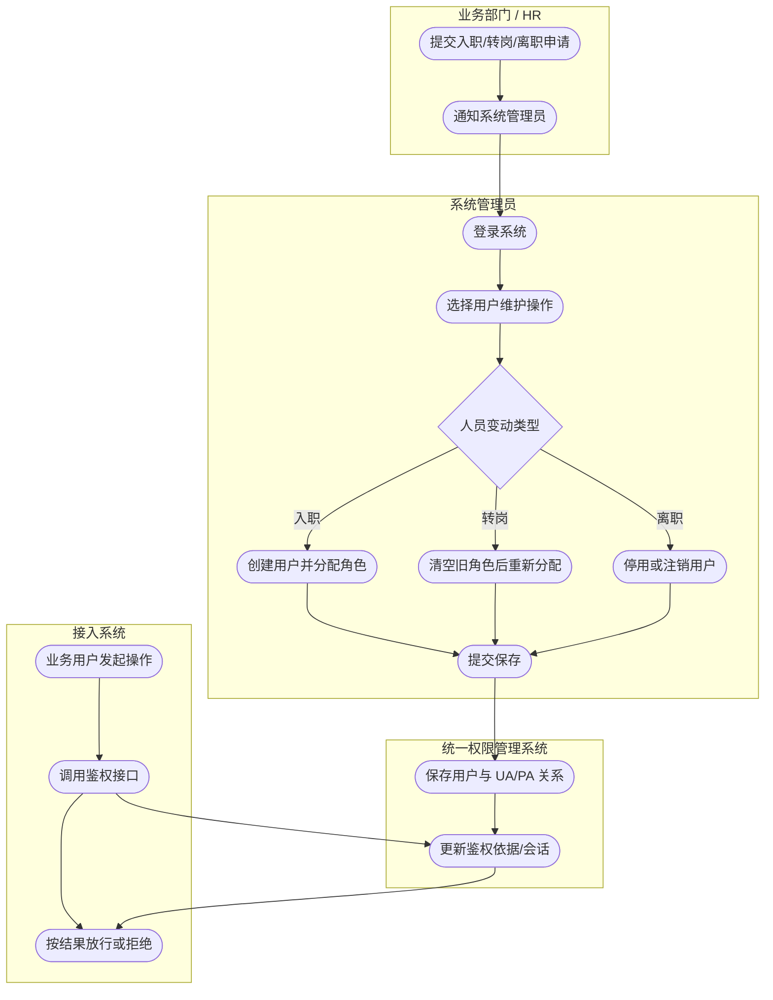
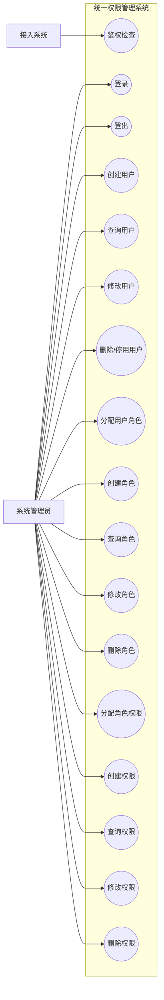
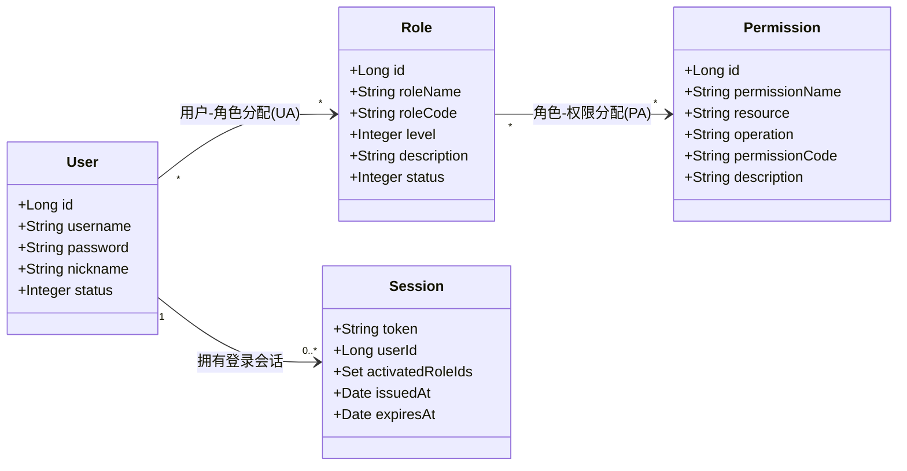
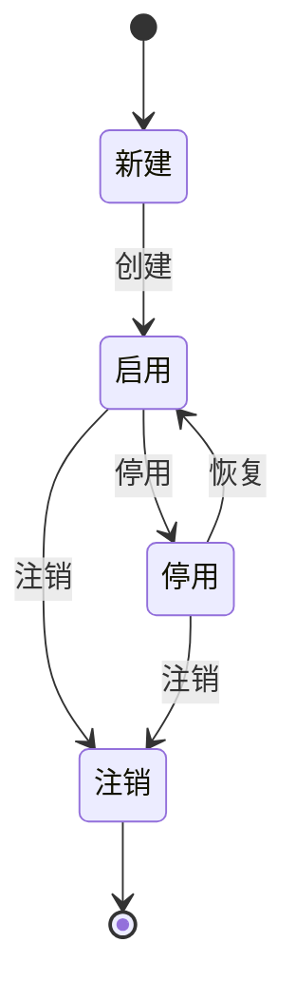
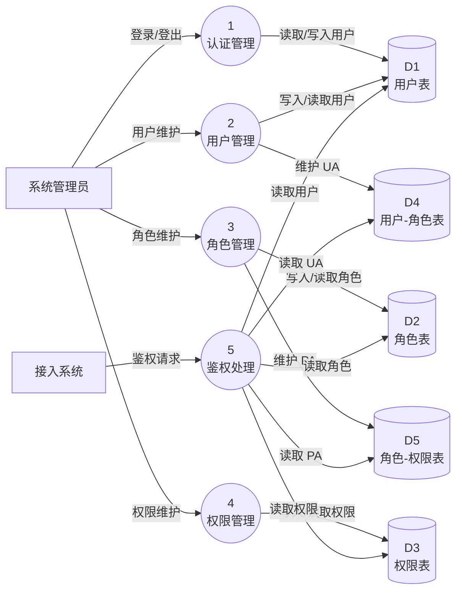

# 统一权限管理系统 需求规格说明书（SRS）

> 文档版本：v1.0
> 编制日期：2026-10-20
> 课程：面向对象分析与设计（OOAD）
> 项目名称：统一权限管理系统（为公司 20+ 软件提供统一鉴权）
> 编制依据：GB/T 9385《计算机软件需求规格说明规范》（对应 IEEE Std 830-1998）
> 说明：本文档沿用上述模板的章、节结构逐节填写，未删减模板章节；并根据课程要求增加「系统分析模型」一章，补充业务流程图、用例模型、活动图、概念类图、状态图与数据流图。

---

## 1. 引言

### 1.1 编写目的

本文档描述“统一权限管理系统”的功能需求与非功能需求，明确系统的边界、参与者、业务规则与分析模型，作为后续界面设计、API 设计、数据库设计、详细设计、代码实现与验收测试的统一依据。

本文档的预期读者包括：

- 课程教师（扮演客户）与项目干系人；
- 项目组成员（需求分析、后端、前端、测试）；
- 后续维护人员与接入系统的集成人员。

### 1.2 项目范围

本系统是公司内部的统一权限管理中心，面向 20 多个既有软件（OA、财务、人事等）提供统一的用户、角色、权限与鉴权服务，避免各系统重复建设权限体系。

第一轮交付范围为 RBAC0 核心框架：

- 实体：用户（User）、角色（Role）、权限（Permission）、会话（Session）；
- 分配关系：用户-角色（UA）、角色-权限（PA）；
- 服务：登录/登出、鉴权检查、用户/角色/权限管理与分配。

本轮不做（后续迭代）：角色继承（RBAC1）、职责分离/约束（RBAC2）、审计日志、单点登录（SSO）、用户同步。

### 1.3 定义、缩写词与缩略语

| 术语 / 缩写 | 说明 |
|------------|------|
| RBAC | Role-Based Access Control，基于角色的访问控制 |
| RBAC0 | 核心 RBAC，仅含用户/角色/权限/会话四实体与 UA、PA 两类分配关系，不含角色继承与职责分离 |
| 用户 User | 使用系统的账号 |
| 角色 Role | 岗位/职能的抽象，是权限的集合 |
| 权限 Permission | 对某资源执行某操作的许可，如「删除 订单」 |
| 会话 Session | 一次登录态，用户可激活其部分角色；本系统第一轮用 JWT 无状态实现 |
| UA | 用户-角色分配关系（多对多） |
| PA | 角色-权限分配关系（多对多） |
| 鉴权 | 判断“某用户能否执行某操作”的过程 |
| 接入系统 | 通过 API 调用本系统做鉴权的 OA 等外部软件 |
| SRS | Software Requirements Specification，软件需求规格说明书 |
| DFD | Data Flow Diagram，数据流图 |
| JWT | JSON Web Token，无状态会话凭证 |
| QPS | Queries Per Second，每秒查询数 |

### 1.4 参考资料

| 编号 | 资料 |
|------|------|
| R1 | 《统一权限管理系统 — 界面设计》（02-界面设计） |
| R2 | 《统一权限管理系统 — API 设计》（03-API设计） |
| R3 | 《统一权限管理系统 — 数据库设计》（04-数据库设计） |
| R4 | 《统一权限管理系统 — 详细设计》（05-详细设计） |
| R5 | 《统一权限管理系统 — 软件设计文档 SDD》（07-SDD） |
| R6 | GB/T 9385 / IEEE Std 830-1998 需求规格说明书模板 |

### 1.5 文档结构

本文档第 1 章为引言，第 2 章为总体描述，第 3 章描述外部接口需求，第 4 章描述功能需求，第 5 章描述非功能需求，第 6 章给出系统分析模型，第 7 章描述数据需求，第 8 章给出验收标准，第 9 章列出待确认问题，第 10 章明确第一轮交付范围。

---

## 2. 总体描述

### 2.1 产品前景

公司内部有 20 多个软件，为避免每个系统各自维护一套权限，建设一个统一的权限管理中心，对外暴露 API，为所有接入系统提供统一的用户、角色、权限与鉴权服务。

系统解决的主要问题：

- 权限分散、重复建设、口径不一致；
- 人员入离职、转岗时权限变更不及时；
- 缺少统一、可配置的角色与权限模型；
- 鉴权逻辑在各系统内硬编码，难以维护。

### 2.2 产品功能

系统主要功能模块：

| 模块 | 功能概述 |
|------|----------|
| 认证与鉴权 | 登录、登出、鉴权检查；登录后建立会话，返回凭证 |
| 用户管理 | 创建、查询、修改、删除/停用用户；管理用户-角色分配 |
| 角色管理 | 创建、查询、修改、删除角色；角色可自定义管理员等级；管理角色-权限分配 |
| 权限管理 | 创建、查询、修改、删除权限；权限由“资源 + 操作”两段式表达 |
| 分配关系管理 | 维护用户-角色（UA）、角色-权限（PA）两类多对多关系 |

### 2.3 用户类与特征

| 用户类 | 说明 | 使用方式 |
|--------|------|----------|
| 系统管理员 | 负责维护用户、角色、权限并完成各类分配 | 通过 Web 管理界面操作 |
| 接入系统（OA 等 20+ 软件） | 需要统一鉴权的外部软件 | 通过 HTTP API 调用鉴权接口，不直接操作管理界面 |
| 普通业务用户 | 使用接入系统的终端用户 | 由接入系统代管，本系统保存其账号并统一判定权限 |

### 2.4 运行环境

| 类别 | 环境 |
|------|------|
| 服务端 | Java 11 + Spring Boot 2.7，提供 RESTful API |
| 数据库 | MySQL 8.x，字符集 utf8mb4 |
| 客户端 | Web 管理界面（Vue 3 + TypeScript + Tailwind CSS） |
| 集成方 | 接入系统通过 HTTP/HTTPS 调用 API |
| 部署 | Docker + docker-compose 一键启动 MySQL 与后端 |

### 2.5 设计与实现的约束

1. **第一轮范围**：仅实现 RBAC0 核心框架，预留 RBAC1/RBAC2 扩展点。
2. **角色、操作、管理员等级全部可自定义**：不写死，运行时数据驱动。
3. **初始无权限（默认拒绝）**：新用户/新角色默认没有任何权限，全靠分配。
4. **统一管理、不定死**：由系统统一管理，不预设固定角色/权限结构。
5. **权限表示方式**：采用“资源 + 操作”两段式，如 `订单:删除`，权限编码形如 `order:delete`。
6. **会话实现**：第一轮用 JWT 无状态实现，不落库；如需踢人下线/会话管理可后续增加 `sys_session`。
7. **技术栈约束**：Spring Boot 2.7 + Spring Data JPA + MySQL 8 + Vue 3。

### 2.6 假设和依赖关系

1. 接入系统与本系统之间网络可达，且鉴权调用为服务间调用。
2. 第一轮用户由本系统本地创建，不从 HR/OA 同步。
3. 第一轮认证采用本地账号密码，不接 SSO/LDAP。
4. 接入系统已具备用户身份，调用鉴权时能提供 `userId`。
5. MySQL 数据库已部署或通过 docker-compose 启动。
6. 早晚高峰存在并发，但具体 QPS 量级待客户确认（见第 9 章）。

---

## 3. 外部接口需求

### 3.1 用户界面

面向系统管理员的后台管理界面，页面结构如下：

- 登录页；
- 首页/布局；
- 用户管理（列表、新增、编辑、分配角色）；
- 角色管理（列表、新增、编辑、分配权限）；
- 权限管理（列表、新增、编辑）。

角色、权限、管理员等级均为运行时数据，界面只负责增删改查与分配；分配角色/权限采用双向穿梭框（左可用、右已选）体现多对多关系。

### 3.2 软件接口

系统对外提供 RESTful API，风格为 REST + JSON，资源用名词复数，方法语义化：

| 模块 | 主要接口 | 说明 |
|------|----------|------|
| 认证 | `POST /api/auth/login`、`POST /api/auth/logout` | 登录/登出 |
| 鉴权 | `GET /api/auth/check?userId=&permissionCode=` | 鉴权检查，返回 `allowed` |
| 用户 | `/api/users` CRUD；`/api/users/{id}/roles` 分配 | 用户管理与用户-角色分配 |
| 角色 | `/api/roles` CRUD；`/api/roles/{id}/permissions` 分配 | 角色管理与角色-权限分配 |
| 权限 | `/api/permissions` CRUD | 权限管理 |

认证方式：登录返回 JWT，除 `login/check` 外请求头携带 `Authorization: Bearer <token>`。统一响应体为 `{ "code": 200, "message": "ok", "data": ... }`。接口详见《API 设计》。

### 3.3 通信接口

- 传输协议：HTTP/HTTPS；
- 数据格式：JSON，字符集 UTF-8；
- 认证凭证：JWT Bearer Token；
- 状态码：200 成功、400 参数/业务错误、401 未认证、403 无权限、404 不存在、500 服务错误。

### 3.4 硬件接口

本系统无特殊硬件接口需求，运行于通用服务器或云主机，依赖 MySQL 数据库服务与可访问的网络。

---

## 4. 功能需求

功能需求按模块组织。优先级说明：P0 为第一轮必须，P1 为重要，P2 为可延后。

### 4.1 认证与鉴权

| 编号 | 需求名称 | 需求描述 | 优先级 | 对应用例 |
|------|----------|----------|--------|----------|
| FR-AUTH-1 | 登录 | 系统管理员用账号密码登录，校验通过后建立会话并返回 JWT 凭证 | P0 | UC-01 |
| FR-AUTH-2 | 登出 | 系统管理员登出，客户端销毁会话凭证 | P0 | UC-02 |
| FR-AUTH-3 | 鉴权检查 | 接入系统传入 `userId + permissionCode`，系统返回是否允许（默认拒绝） | P0 | UC-03 |
| FR-AUTH-4 | 会话 | 登录后依据用户激活的角色集合作为鉴权依据（RBAC0 的 Session） | P0 | UC-01/UC-03 |

### 4.2 用户管理

| 编号 | 需求名称 | 需求描述 | 优先级 | 对应用例 |
|------|----------|----------|--------|----------|
| FR-USER-1 | 创建用户 | 创建账号、密码、昵称等基本信息；账号唯一 | P0 | UC-04 |
| FR-USER-2 | 查询用户 | 支持用户列表与详情查询 | P0 | UC-05 |
| FR-USER-3 | 修改用户 | 修改昵称、状态，可重置密码 | P0 | UC-06 |
| FR-USER-4 | 删除/停用用户 | 删除用户或通过状态流转停用/注销 | P0 | UC-07 |
| FR-USER-5 | 分配用户角色 | 给用户整体设置一个或多个角色 | P0 | UC-08 |
| FR-USER-6 | 移除用户角色 | 移除用户单个角色或清空全部角色 | P0 | UC-08 |

### 4.3 角色管理

| 编号 | 需求名称 | 需求描述 | 优先级 | 对应用例 |
|------|----------|----------|--------|----------|
| FR-ROLE-1 | 创建角色 | 创建角色（名称、编码、描述），编码唯一 | P0 | UC-09 |
| FR-ROLE-2 | 查询角色 | 支持角色列表与详情查询 | P0 | UC-10 |
| FR-ROLE-3 | 修改角色 | 修改角色名称、管理员等级、描述、状态 | P0 | UC-11 |
| FR-ROLE-4 | 删除角色 | 删除角色，其关联权限即时对用户失效 | P0 | UC-12 |
| FR-ROLE-5 | 自定义管理员等级 | 角色可标记管理员等级，等级可自定义（`level` 字段） | P0 | UC-09/UC-11 |

### 4.4 权限管理

| 编号 | 需求名称 | 需求描述 | 优先级 | 对应用例 |
|------|----------|----------|--------|----------|
| FR-PERM-1 | 创建权限 | 创建权限（资源 + 操作），生成唯一权限编码 | P0 | UC-14 |
| FR-PERM-2 | 查询权限 | 支持权限列表与详情查询 | P0 | UC-15 |
| FR-PERM-3 | 修改权限 | 修改权限名称、资源、操作、描述 | P0 | UC-16 |
| FR-PERM-4 | 删除权限 | 删除权限 | P0 | UC-17 |
| FR-PERM-5 | 分配角色权限 | 给角色整体设置一个或多个权限 | P0 | UC-13 |
| FR-PERM-6 | 移除角色权限 | 移除角色单个权限 | P0 | UC-13 |

### 4.5 分配关系（RBAC0 核心）

- 用户 ↔ 角色：多对多（UA），通过 `sys_user_role` 表达；
- 角色 ↔ 权限：多对多（PA），通过 `sys_role_permission` 表达；
- 用户不直接持有权限，只能通过角色间接获得权限；
- 鉴权路径：`用户 →(UA)→ 角色 →(PA)→ 权限`。

---

## 5. 非功能需求

以下性能/可靠性的量化指标为建议目标值，具体 QPS 等参数待客户确认（见第 9 章）。

### 5.1 性能需求

| 编号 | 需求 | 说明 / 验收指标 |
|------|------|------------------|
| NFR-PERF-1 | 鉴权响应 | 普通负载下鉴权接口 P95 响应时间 ≤ 200ms（目标值） |
| NFR-PERF-2 | 高峰并发 | 早晚高峰鉴权请求量增大，通过索引与缓存保障响应；设计目标暂按 1000 QPS 评估（待确认） |
| NFR-PERF-3 | 管理接口响应 | 管理类接口 P95 响应时间 ≤ 500ms（目标值） |
| NFR-PERF-4 | 鉴权查询 | 鉴权采用单条联表 COUNT 查询，避免逐级多次查询 |

### 5.2 安全需求

| 编号 | 需求 | 说明 |
|------|------|------|
| NFR-SEC-1 | 默认拒绝 | 未命中权限的用户/角色默认无任何操作权限，鉴权返回 `false` |
| NFR-SEC-2 | 密码存储 | 密码使用 BCrypt 加密存储，禁止明文 |
| NFR-SEC-3 | 会话安全 | JWT 带签名与过期时间；除 login/check 外接口需认证 |
| NFR-SEC-4 | 越权防护 | 鉴权以服务端持久化数据为准，不信任客户端传入的权限 |

### 5.3 可靠性需求

| 编号 | 需求 | 说明 |
|------|------|------|
| NFR-REL-1 | 可用性 | 系统可用性 ≥ 99.9%（目标值） |
| NFR-REL-2 | 数据一致性 | 用户/角色/权限及其分配关系写入使用事务，保证一致 |
| NFR-REL-3 | 降级 | 鉴权依赖数据库，若缓存不可用应回源查询，保证结果正确 |

### 5.4 易用性 / 可用性需求

| 编号 | 需求 | 说明 |
|------|------|------|
| NFR-USE-1 | 操作效率 | 常见管理任务（新增、分配）在 3 步内完成 |
| NFR-USE-2 | 可视化分配 | 用户-角色、角色-权限使用双向穿梭框 |
| NFR-USE-3 | 即时反馈 | 表单校验与操作结果即时提示 |

### 5.5 可维护性需求

| 编号 | 需求 | 说明 |
|------|------|------|
| NFR-MAINT-1 | 分层架构 | Controller → Service → Repository → Entity 分层，职责单一 |
| NFR-MAINT-2 | 数据驱动 | 角色、权限、等级运行时可配置，新增无需改代码 |
| NFR-MAINT-3 | 可测试 | 关键业务（鉴权、登录、用户/角色/权限服务）具备单元测试 |
| NFR-MAINT-4 | 扩展性 | 预留 RBAC1（角色继承）、RBAC2（职责分离）扩展点 |

### 5.6 可移植性需求

| 编号 | 需求 | 说明 |
|------|------|------|
| NFR-PORT-1 | 容器化 | 使用 Docker/docker-compose 一键部署 MySQL 与后端 |
| NFR-PORT-2 | 数据库兼容 | 兼容 MySQL 8.x，字符集 utf8mb4 |

### 5.7 业务规则与约束

1. **初始无权限**：新用户不分配任何角色即无任何权限；新角色不分配权限即无权限。
2. **默认拒绝**：鉴权未命中权限码即返回 `false`。
3. **生命周期**：用户/角色具备状态流转（创建 → 启用 → 停用 → 注销），停用后鉴权立即拒绝。
4. **跨部门回收**：人员换部门时旧权限立即全部失效（清空该用户全部角色），随后重新分配。
5. **角色/权限回收即时生效**：删除或停用角色后，关联用户即时失去对应权限。

---

## 6. 系统分析模型

本章为课程要求的分析模型补充，服务于需求澄清与后续设计。

### 6.1 业务流程图（泳道图）

描述“用户权限全生命周期”业务主流程，涉及业务部门/HR、系统管理员、统一权限管理系统、接入系统四条泳道。



### 6.2 用例模型

#### 6.2.1 用例图

> 说明：因 Markdown 的 Mermaid 未提供原生 UML 用例图语法，以下采用等价表示：`(())` 为用例，矩形为参与者，连线为关联关系。



#### 6.2.2 用例文档（详述）

用例文档采用统一格式：参与者、触发条件、前置条件、主成功场景（基本流）、扩展/异常流、后置条件、优先级。

##### UC-01 登录

| 字段 | 内容 |
|------|------|
| 用例编号 | UC-01 |
| 用例名称 | 登录 |
| 参与者 | 系统管理员 |
| 触发条件 | 管理员进入登录页并提交账号密码 |
| 前置条件 | 系统已启动，用户账号已存在 |
| 主成功场景 | 1. 管理员输入账号密码；2. 系统校验账号存在且密码匹配；3. 系统校验用户状态为启用；4. 系统生成 JWT 并返回登录成功。 |
| 扩展/异常流 | 2a. 账号或密码错误 → 提示“账号或密码错误”；3a. 用户已停用 → 提示“账号已停用”。 |
| 后置条件 | 建立登录会话，客户端持有 JWT |
| 优先级 | P0 |

##### UC-02 登出

| 字段 | 内容 |
|------|------|
| 用例编号 | UC-02 |
| 用例名称 | 登出 |
| 参与者 | 系统管理员 |
| 触发条件 | 管理员点击登出 |
| 前置条件 | 管理员已登录 |
| 主成功场景 | 1. 管理员发起登出；2. 客户端销毁本地 JWT 会话凭证；3. 返回登录页。 |
| 扩展/异常流 | 无 |
| 后置条件 | 当前会话失效 |
| 优先级 | P0 |

##### UC-03 鉴权检查

| 字段 | 内容 |
|------|------|
| 用例编号 | UC-03 |
| 用例名称 | 鉴权检查 |
| 参与者 | 接入系统（OA 等） |
| 触发条件 | 业务用户在接入系统发起受控操作 |
| 前置条件 | 接入系统能提供 userId 与目标 permissionCode |
| 主成功场景 | 1. 接入系统提交 `userId + permissionCode`；2. 系统沿“用户 → 角色 → 权限”路径查询；3. 命中权限则返回 `allowed=true`。 |
| 扩展/异常流 | 2a. 用户不存在/停用 → 返回 `allowed=false`；2b. 未命中权限 → 返回 `allowed=false`（默认拒绝）。 |
| 后置条件 | 返回鉴权结果，接入系统据此放行或拦截 |
| 优先级 | P0 |

##### UC-04 创建用户

| 字段 | 内容 |
|------|------|
| 用例编号 | UC-04 |
| 用例名称 | 创建用户 |
| 参与者 | 系统管理员 |
| 触发条件 | 管理员在用户管理页点击“新增用户” |
| 前置条件 | 管理员已登录且具备用户管理权限 |
| 主成功场景 | 1. 管理员填写账号、密码、昵称；2. 系统校验账号唯一；3. 系统加密存储密码并保存用户；4. 返回创建成功。 |
| 扩展/异常流 | 2a. 账号已存在 → 提示“账号已存在”；2b. 必填项缺失 → 提示校验错误。 |
| 后置条件 | 新增用户记录，默认无角色、无权限 |
| 优先级 | P0 |

##### UC-05 查询用户

| 字段 | 内容 |
|------|------|
| 用例编号 | UC-05 |
| 用例名称 | 查询用户 |
| 参与者 | 系统管理员 |
| 触发条件 | 管理员进入用户管理页或点击查看详情 |
| 前置条件 | 管理员已登录 |
| 主成功场景 | 1. 系统返回用户列表；2. 管理员选择用户查看详情（含已分配角色）。 |
| 扩展/异常流 | 1a. 用户不存在 → 提示“用户不存在”。 |
| 后置条件 | 显示用户信息 |
| 优先级 | P0 |

##### UC-06 修改用户

| 字段 | 内容 |
|------|------|
| 用例编号 | UC-06 |
| 用例名称 | 修改用户 |
| 参与者 | 系统管理员 |
| 触发条件 | 管理员点击“编辑用户” |
| 前置条件 | 目标用户已存在，管理员已登录 |
| 主成功场景 | 1. 管理员修改昵称/状态或重置密码；2. 系统校验并保存；3. 返回修改成功。 |
| 扩展/异常流 | 2a. 校验失败 → 提示错误。 |
| 后置条件 | 用户信息更新；若改为停用则鉴权立即拒绝 |
| 优先级 | P0 |

##### UC-07 删除/停用用户

| 字段 | 内容 |
|------|------|
| 用例编号 | UC-07 |
| 用例名称 | 删除/停用用户 |
| 参与者 | 系统管理员 |
| 触发条件 | 管理员对用户执行删除或停用操作 |
| 前置条件 | 目标用户已存在，管理员已登录 |
| 主成功场景 | 1. 管理员确认删除或停用；2. 系统删除用户或置状态为停用/注销；3. 返回成功。 |
| 扩展/异常流 | 1a. 用户不存在 → 提示“用户不存在”；1b. 删除受保护账号 → 拒绝。 |
| 后置条件 | 用户不可再登录/鉴权；关联 UA 关系解除 |
| 优先级 | P0 |

##### UC-08 分配用户角色

| 字段 | 内容 |
|------|------|
| 用例编号 | UC-08 |
| 用例名称 | 分配用户角色（含跨部门回收） |
| 参与者 | 系统管理员 |
| 触发条件 | 管理员在用户管理页点击“分配角色” |
| 前置条件 | 用户与角色均已存在 |
| 主成功场景 | 1. 管理员选择用户并勾选目标角色集合；2. 系统整体替换该用户的角色集合；3. 保存 UA 关系并返回成功。 |
| 扩展/异常流 | 2a. 角色集合为空 → 清空该用户全部角色（跨部门“杀死重开”）；2b. 角色不存在或已停用 → 提示错误。 |
| 后置条件 | 用户权限随角色集合更新，旧权限立即失效 |
| 优先级 | P0 |

##### UC-09 创建角色

| 字段 | 内容 |
|------|------|
| 用例编号 | UC-09 |
| 用例名称 | 创建角色 |
| 参与者 | 系统管理员 |
| 触发条件 | 管理员点击“新增角色” |
| 前置条件 | 管理员已登录且具备角色管理权限 |
| 主成功场景 | 1. 管理员填写角色名、编码、等级、描述；2. 系统校验编码唯一；3. 保存角色；4. 返回成功。 |
| 扩展/异常流 | 2a. 编码重复 → 提示“角色编码已存在”。 |
| 后置条件 | 新增角色记录，默认无权限 |
| 优先级 | P0 |

##### UC-10 查询角色

| 字段 | 内容 |
|------|------|
| 用例编号 | UC-10 |
| 用例名称 | 查询角色 |
| 参与者 | 系统管理员 |
| 触发条件 | 管理员进入角色管理页或查看详情 |
| 前置条件 | 管理员已登录 |
| 主成功场景 | 1. 系统返回角色列表；2. 管理员查看角色详情（含管理员等级、状态、已分配权限）。 |
| 扩展/异常流 | 1a. 角色不存在 → 提示“角色不存在”。 |
| 后置条件 | 显示角色信息 |
| 优先级 | P0 |

##### UC-11 修改角色

| 字段 | 内容 |
|------|------|
| 用例编号 | UC-11 |
| 用例名称 | 修改角色 |
| 参与者 | 系统管理员 |
| 触发条件 | 管理员点击“编辑角色” |
| 前置条件 | 目标角色已存在 |
| 主成功场景 | 1. 管理员修改角色名、等级、描述、状态；2. 系统校验并保存；3. 返回成功。 |
| 扩展/异常流 | 2a. 校验失败 → 提示错误。 |
| 后置条件 | 角色信息更新；若停用，关联用户立即失去该角色权限 |
| 优先级 | P0 |

##### UC-12 删除角色

| 字段 | 内容 |
|------|------|
| 用例编号 | UC-12 |
| 用例名称 | 删除角色 |
| 参与者 | 系统管理员 |
| 触发条件 | 管理员点击“删除角色” |
| 前置条件 | 目标角色已存在 |
| 主成功场景 | 1. 管理员确认删除；2. 系统删除角色并解除相关 UA/PA 关系；3. 返回成功。 |
| 扩展/异常流 | 1a. 角色不存在 → 提示“角色不存在”；1b. 受保护内置角色 → 拒绝。 |
| 后置条件 | 角色删除，关联用户即时失去该角色权限 |
| 优先级 | P0 |

##### UC-13 分配角色权限

| 字段 | 内容 |
|------|------|
| 用例编号 | UC-13 |
| 用例名称 | 分配角色权限 |
| 参与者 | 系统管理员 |
| 触发条件 | 管理员在角色管理页点击“分配权限” |
| 前置条件 | 角色与权限均已存在 |
| 主成功场景 | 1. 管理员勾选目标权限集合；2. 系统整体替换该角色的权限集合；3. 保存 PA 关系并返回成功。 |
| 扩展/异常流 | 2a. 权限集合为空 → 清空角色权限；2b. 权限不存在 → 提示错误。 |
| 后置条件 | 拥有该角色的用户权限即时更新 |
| 优先级 | P0 |

##### UC-14 创建权限

| 字段 | 内容 |
|------|------|
| 用例编号 | UC-14 |
| 用例名称 | 创建权限 |
| 参与者 | 系统管理员 |
| 触发条件 | 管理员点击“新增权限” |
| 前置条件 | 管理员已登录且具备权限管理权限 |
| 主成功场景 | 1. 管理员填写权限名、资源、操作、编码、描述；2. 系统校验编码唯一；3. 保存权限；4. 返回成功。 |
| 扩展/异常流 | 2a. 编码重复 → 提示“权限编码已存在”。 |
| 后置条件 | 新增权限记录 |
| 优先级 | P0 |

##### UC-15 查询权限

| 字段 | 内容 |
|------|------|
| 用例编号 | UC-15 |
| 用例名称 | 查询权限 |
| 参与者 | 系统管理员 |
| 触发条件 | 管理员进入权限管理页或查看详情 |
| 前置条件 | 管理员已登录 |
| 主成功场景 | 1. 系统返回权限列表（按资源分组展示）。 |
| 扩展/异常流 | 1a. 权限不存在 → 提示“权限不存在”。 |
| 后置条件 | 显示权限信息 |
| 优先级 | P0 |

##### UC-16 修改权限

| 字段 | 内容 |
|------|------|
| 用例编号 | UC-16 |
| 用例名称 | 修改权限 |
| 参与者 | 系统管理员 |
| 触发条件 | 管理员点击“编辑权限” |
| 前置条件 | 目标权限已存在 |
| 主成功场景 | 1. 管理员修改权限名、资源、操作、描述；2. 系统校验并保存；3. 返回成功。 |
| 扩展/异常流 | 2a. 校验失败 → 提示错误。 |
| 后置条件 | 权限信息更新 |
| 优先级 | P0 |

##### UC-17 删除权限

| 字段 | 内容 |
|------|------|
| 用例编号 | UC-17 |
| 用例名称 | 删除权限 |
| 参与者 | 系统管理员 |
| 触发条件 | 管理员点击“删除权限” |
| 前置条件 | 目标权限已存在 |
| 主成功场景 | 1. 管理员确认删除；2. 系统删除权限并解除相关 PA 关系；3. 返回成功。 |
| 扩展/异常流 | 1a. 权限不存在 → 提示“权限不存在”。 |
| 后置条件 | 权限删除，相关角色的该权限即时失效 |
| 优先级 | P0 |

### 6.3 复杂用例活动图 / 泳道图

选择 UC-08「分配用户角色」作为复杂用例，因其涉及“整体替换/清空角色”的跨部门回收规则与数据校验分支，采用泳道图描述。

```mermaid
flowchart TD
    subgraph Admin["系统管理员"]
        A1([进入用户管理页]) --> A2([选择目标用户])
        A2 --> A3([打开分配角色弹窗])
        A3 --> A4([勾选角色集合并提交])
    end

    subgraph Sys["统一权限管理系统"]
        S1([接收 userId 与 roleIds]) --> S2{roleIds 是否为空}
        S2 --|空(跨部门回收)| S3([清空该用户全部角色])
        S2 --|非空| S4([校验角色存在且启用])
        S4 --> S5{校验是否通过}
        S5 --|否| S6([返回错误提示])
        S5 --|是| S7([整体替换用户-角色关联])
        S3 --> S8([持久化 UA 关系])
        S7 --> S8
        S8 --> S9([返回成功提示])
    end

    subgraph DB["数据库"]
        D1[("sys_user_role")]
    end

    A4 --> S1
    S8 --> D1
```

补充：登录（UC-01）也可用简单活动图描述，其决策分支为“密码校验”与“状态校验”。

```mermaid
flowchart TD
    L1([管理员输入账号密码]) --> L2([提交登录])
    L2 --> L3{账号存在且密码匹配}
    L3 --|否| L4([提示账号或密码错误])
    L3 --|是| L5{用户状态是否启用}
    L5 --|否| L6([提示账号已停用])
    L5 --|是| L7([生成 JWT 并返回])
```

### 6.4 概念类图

概念类图描述领域模型（不含实现类），与《详细设计》中的实现类图相区分。



### 6.5 复杂类状态图

选择「用户（User）」作为复杂类，描述其生命周期状态流转。



状态说明：

| 状态 | 含义 | 鉴权行为 |
|------|------|----------|
| 新建 | 初始状态，尚未启用 | 默认拒绝 |
| 启用 | 正常可用 | 可登录、可鉴权 |
| 停用 | 临时禁用 | 鉴权立即拒绝 |
| 注销 | 永久失效 | 不可恢复、不可鉴权 |

角色（Role）采用类似状态机：创建 → 启用 → 停用，停用或删除后关联用户立即失去该角色权限。

### 6.6 数据流图（DFD）

#### 6.6.1 顶层数据流图（0 层 / 上下文图）

```mermaid
flowchart LR
    Admin["系统管理员"] -->|用户/角色/权限管理与分配请求| P0(("0<br/>统一权限管理系统"))
    P0 -->|操作结果/查询数据| Admin
    Ext["接入系统"] -->|鉴权请求(用户+权限码)| P0
    P0 -->|鉴权结果(允许/拒绝)| Ext
```

#### 6.6.2 第 1 层数据流图（功能级分解）



---

## 7. 数据需求

### 7.1 数据逻辑结构

核心 5 张表，对应 RBAC0 概念：

| 表 | 作用 | 对应概念 |
|----|------|----------|
| sys_user | 用户 | User |
| sys_role | 角色（含可自定义管理员等级 level） | Role |
| sys_permission | 权限（= 资源 + 操作） | Permission |
| sys_user_role | 用户-角色 多对多 | UA |
| sys_role_permission | 角色-权限 多对多 | PA |

会话（Session）第一轮以 JWT 无状态实现，不落库；如需“踢人下线/会话管理”可后续增加 `sys_session` 表。

### 7.2 数据字典摘要

| 表 | 关键字段 | 约束 / 说明 |
|----|----------|-------------|
| sys_user | id, username, password, nickname, status | username 唯一；password 加密；status 1启用 0停用 |
| sys_role | id, role_name, role_code, level, description, status | role_code 唯一；level 可自定义，数值越小等级越高 |
| sys_permission | id, permission_name, resource, operation, permission_code | permission_code 唯一，如 `order:delete` |
| sys_user_role | id, user_id, role_id | (user_id, role_id) 唯一 |
| sys_role_permission | id, role_id, permission_id | (role_id, permission_id) 唯一 |

完整建表 SQL 与初始化数据见《数据库设计》。

---

## 8. 验收标准

| 编号 | 验收项 | 判定标准 |
|------|--------|----------|
| AC-1 | 登录/登出 | 正确账号密码可登录并返回 JWT；错误密码、停用账号被拒绝 |
| AC-2 | 鉴权检查 | 命中权限返回 true，未命中/停用/不存在返回 false（默认拒绝） |
| AC-3 | 用户/角色/权限 CRUD | 增删改查符合 API 约定，唯一性冲突被拦截 |
| AC-4 | 分配关系 | 用户-角色、角色-权限可整体设置、清空、移除单个 |
| AC-5 | 跨部门回收 | 清空用户角色后，旧权限立即失效 |
| AC-6 | 生命周期 | 停用用户后鉴权立即拒绝；状态可恢复 |
| AC-7 | 安全 | 密码非明文；接口认证拦截生效 |
| AC-8 | 默认拒绝 | 新建用户/角色在未分配前无任何权限 |

---

## 9. 待确认问题

| # | 问题 | 影响 |
|---|------|------|
| 1 | 权限表示方式是“资源+操作”两段式，还是允许更多层级？ | permission 表设计 |
| 2 | 用户是本地建账号，还是从 HR/OA 同步？ | 用户来源、是否需要同步接口 |
| 3 | 登录认证是本系统账号密码，还是要对接 SSO/LDAP？ | 认证方式与鉴权接口形态 |
| 4 | “管理员等级可自定义”是角色上的等级字段，还是独立分级体系？ | role 表字段设计 |
| 5 | “跨部门杀死重开”是人工触发还是自动触发？触发条件？ | 生命周期接口与状态机 |
| 6 | 生命周期具体状态与可流转路径？ | 状态机与接口 |
| 7 | 鉴权 API 是每次实时调本系统，还是下发权限快照？ | 性能与接口设计 |
| 8 | 高峰并发量级（QPS）？ | 是否引入缓存/异步 |
| 9 | 是否需要操作审计日志？ | 是否增加审计模块 |

---

## 10. 第一轮交付范围（RBAC0）

**做**：

- 用户、角色、权限、会话四实体；
- 用户-角色分配（UA）、角色-权限分配（PA）；
- 登录/登出、鉴权检查 API；
- 用户/角色/权限管理与分配；
- Web 管理界面原型。

**不做**（第二、三轮）：

- 角色继承（RBAC1）；
- 职责分离/约束（RBAC2）；
- 审计日志；
- 单点登录（SSO）；
- 用户同步。
