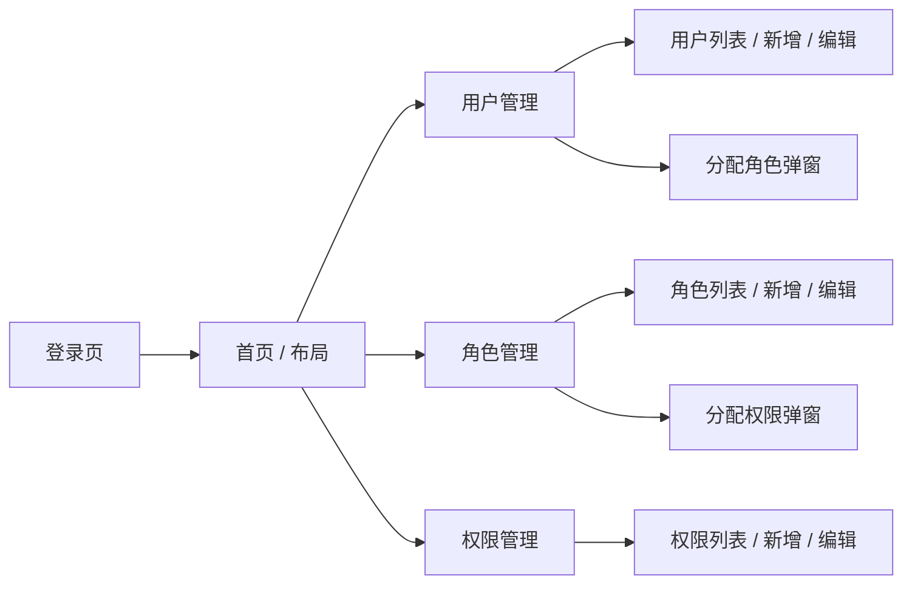

# 统一权限管理系统 — 界面设计

> 形式：ASCII 线框图 + Mermaid 导航结构图。
> 面向系统管理员的后台管理界面。

---

## 1. 页面结构（导航）



---

## 2. 页面线框图

### 2.1 登录页
```
┌────────────────────────────┐
│        统一权限管理系统      │
│                            │
│   账号: [____________]     │
│   密码: [____________]     │
│                            │
│        [ 登 录 ]           │
└────────────────────────────┘
```

### 2.2 用户管理页
```
┌──────────────────────────────────────────────┐
│ 用户管理                        [+ 新增用户]    │
├────────┬────────┬────────┬───────┬────────────┤
│ 账号   │ 昵称   │ 状态   │ 角色   │ 操作       │
├────────┼────────┼────────┼───────┼────────────┤
│ admin  │ 管理员  │ 启用   │ 超级管理员│ [编辑][分配角色][删除] │
│ zhang  │ 张三    │ 启用   │ 财务    │ [编辑][分配角色][删除] │
│ li     │ 李四    │ 停用   │ (无)    │ [编辑][分配角色][删除] │
└────────┴────────┴────────┴───────┴────────────┘
```

**新增/编辑用户弹窗**：账号、密码、昵称、状态。
**分配角色弹窗**：左侧可用角色列表 ⇄ 右侧已分配角色（多对多勾选）。

### 2.3 角色管理页
```
┌──────────────────────────────────────────────┐
│ 角色管理                        [+ 新增角色]    │
├──────────┬────────┬──────┬──────┬────────────┤
│ 角色名    │ 编码   │ 等级  │ 状态 │ 操作       │
├──────────┼────────┼──────┼──────┼────────────┤
│ 超级管理员 │ SUPER  │ 0    │ 启用 │ [编辑][分配权限][删除] │
│ 财务专员   │ FIN    │ 2    │ 启用 │ [编辑][分配权限][删除] │
└──────────┴────────┴──────┴──────┴────────────┘
```

**新增/编辑角色弹窗**：角色名、编码、等级（可自定义）、描述、状态。
**分配权限弹窗**：左侧可用权限列表 ⇄ 右侧已分配权限（按资源分组勾选）。

### 2.4 权限管理页
```
┌──────────────────────────────────────────────┐
│ 权限管理                        [+ 新增权限]    │
├──────────┬────────┬────────┬─────────┬────────┤
│ 权限名    │ 资源   │ 操作   │ 编码     │ 操作   │
├──────────┼────────┼────────┼─────────┼────────┤
│ 创建用户  │ user  │ create │ user:create│ [编辑][删除] │
│ 删除订单  │ order │ delete │ order:delete│ [编辑][删除] │
└──────────┴────────┴────────┴─────────┴────────┘
```

**新增/编辑权限弹窗**：权限名、资源、操作、编码、描述。

---

## 3. 交互说明
- 角色、权限、管理员等级均为**运行时数据**，界面只负责增删改查与分配，不写死任何固定项。
- 分配角色/权限用**双向穿梭框**（左可用、右已选），体现多对多关系。
- 删除/停用角色后，关联用户即时失去对应权限（生命周期）。
