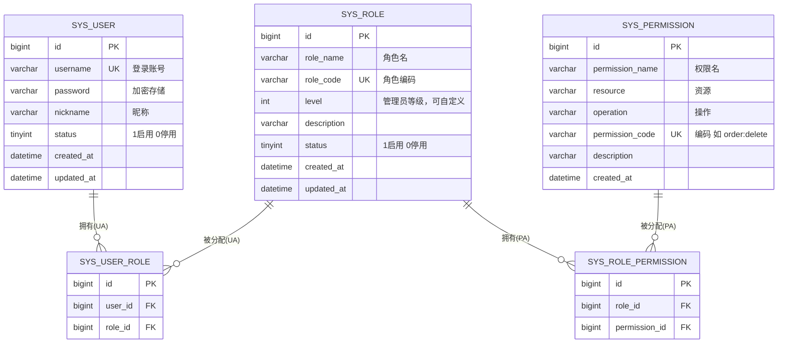

# 统一权限管理系统 — 数据库设计

> 数据库：MySQL 8.x；字符集 utf8mb4。
> 范围：RBAC0 核心 5 张表。

---

## 1. ER 图



---

## 2. 表结构说明

| 表 | 作用 | 对应 RBAC0 概念 |
|----|------|----------------|
| sys_user | 用户 | User |
| sys_role | 角色（含可自定义的管理员等级 level） | Role |
| sys_permission | 权限（= 资源 + 操作） | Permission |
| sys_user_role | 用户-角色 多对多 | UA |
| sys_role_permission | 角色-权限 多对多 | PA |

> 会话（Session）：RBAC0 的会话对应登录态。第一轮用 JWT 无状态实现（token 即会话凭证），故不落库。若后续需"踢人下线/会话管理"，可加 `sys_session` 表记录 token 与激活角色。

---

## 3. 建表 SQL

```sql
CREATE DATABASE IF NOT EXISTS `rbac` DEFAULT CHARACTER SET utf8mb4;
USE `rbac`;

-- 用户表
CREATE TABLE `sys_user` (
  `id`          BIGINT       NOT NULL AUTO_INCREMENT COMMENT '主键',
  `username`    VARCHAR(64)  NOT NULL                COMMENT '登录账号',
  `password`    VARCHAR(128) NOT NULL                COMMENT '密码(加密存储)',
  `nickname`    VARCHAR(64)  DEFAULT NULL            COMMENT '昵称',
  `status`      TINYINT      NOT NULL DEFAULT 1      COMMENT '状态 1启用 0停用',
  `created_at`  DATETIME     NOT NULL DEFAULT CURRENT_TIMESTAMP,
  `updated_at`  DATETIME     NOT NULL DEFAULT CURRENT_TIMESTAMP ON UPDATE CURRENT_TIMESTAMP,
  PRIMARY KEY (`id`),
  UNIQUE KEY `uk_username` (`username`)
) ENGINE=InnoDB DEFAULT CHARSET=utf8mb4 COMMENT='用户表';

-- 角色表（可自定义，level 为管理员等级）
CREATE TABLE `sys_role` (
  `id`          BIGINT       NOT NULL AUTO_INCREMENT COMMENT '主键',
  `role_name`   VARCHAR(64)  NOT NULL                COMMENT '角色名称',
  `role_code`   VARCHAR(64)  NOT NULL                COMMENT '角色编码',
  `level`       INT          NOT NULL DEFAULT 0      COMMENT '管理员等级(可自定义,数值越小等级越高)',
  `description` VARCHAR(255) DEFAULT NULL            COMMENT '描述',
  `status`      TINYINT      NOT NULL DEFAULT 1      COMMENT '状态 1启用 0停用',
  `created_at`  DATETIME     NOT NULL DEFAULT CURRENT_TIMESTAMP,
  `updated_at`  DATETIME     NOT NULL DEFAULT CURRENT_TIMESTAMP ON UPDATE CURRENT_TIMESTAMP,
  PRIMARY KEY (`id`),
  UNIQUE KEY `uk_role_code` (`role_code`)
) ENGINE=InnoDB DEFAULT CHARSET=utf8mb4 COMMENT='角色表';

-- 权限表（= 资源 + 操作，可自定义）
CREATE TABLE `sys_permission` (
  `id`              BIGINT       NOT NULL AUTO_INCREMENT COMMENT '主键',
  `permission_name` VARCHAR(64)  NOT NULL                COMMENT '权限名称',
  `resource`        VARCHAR(64)  NOT NULL                COMMENT '资源',
  `operation`       VARCHAR(64)  NOT NULL                COMMENT '操作',
  `permission_code` VARCHAR(128) NOT NULL                COMMENT '权限编码 如 order:delete',
  `description`     VARCHAR(255) DEFAULT NULL            COMMENT '描述',
  `created_at`      DATETIME     NOT NULL DEFAULT CURRENT_TIMESTAMP,
  PRIMARY KEY (`id`),
  UNIQUE KEY `uk_permission_code` (`permission_code`)
) ENGINE=InnoDB DEFAULT CHARSET=utf8mb4 COMMENT='权限表';

-- 用户-角色关联表（多对多）
CREATE TABLE `sys_user_role` (
  `id`      BIGINT NOT NULL AUTO_INCREMENT COMMENT '主键',
  `user_id` BIGINT NOT NULL COMMENT '用户ID',
  `role_id` BIGINT NOT NULL COMMENT '角色ID',
  PRIMARY KEY (`id`),
  UNIQUE KEY `uk_user_role` (`user_id`, `role_id`),
  KEY `idx_role_id` (`role_id`)
) ENGINE=InnoDB DEFAULT CHARSET=utf8mb4 COMMENT='用户-角色关联表';

-- 角色-权限关联表（多对多）
CREATE TABLE `sys_role_permission` (
  `id`            BIGINT NOT NULL AUTO_INCREMENT COMMENT '主键',
  `role_id`       BIGINT NOT NULL COMMENT '角色ID',
  `permission_id` BIGINT NOT NULL COMMENT '权限ID',
  PRIMARY KEY (`id`),
  UNIQUE KEY `uk_role_perm` (`role_id`, `permission_id`),
  KEY `idx_permission_id` (`permission_id`)
) ENGINE=InnoDB DEFAULT CHARSET=utf8mb4 COMMENT='角色-权限关联表';
```

---

## 4. 初始化数据（示例）

```sql
-- 超级管理员角色（level=0 最高）
INSERT INTO sys_role (role_name, role_code, level, description) VALUES
  ('超级管理员', 'SUPER_ADMIN', 0, '系统内置最高管理员');

-- 初始权限示例（= 资源 + 操作）
INSERT INTO sys_permission (permission_name, resource, operation, permission_code, description) VALUES
  ('创建用户',   'user', 'create', 'user:create', '创建用户'),
  ('查看用户',   'user', 'read',   'user:read',   '查看用户'),
  ('修改用户',   'user', 'update', 'user:update', '修改用户'),
  ('删除用户',   'user', 'delete', 'user:delete', '删除用户'),
  ('创建角色',   'role', 'create', 'role:create', '创建角色'),
  ('分配角色权限','role', 'assign', 'role:assign', '给角色分配权限');
```

> 注意：符合"初始无权限"原则 —— 新用户不分配任何角色，就什么权限都没有。
