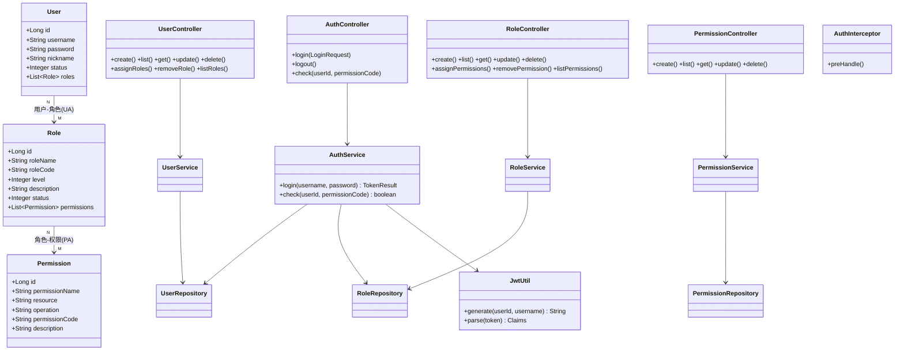
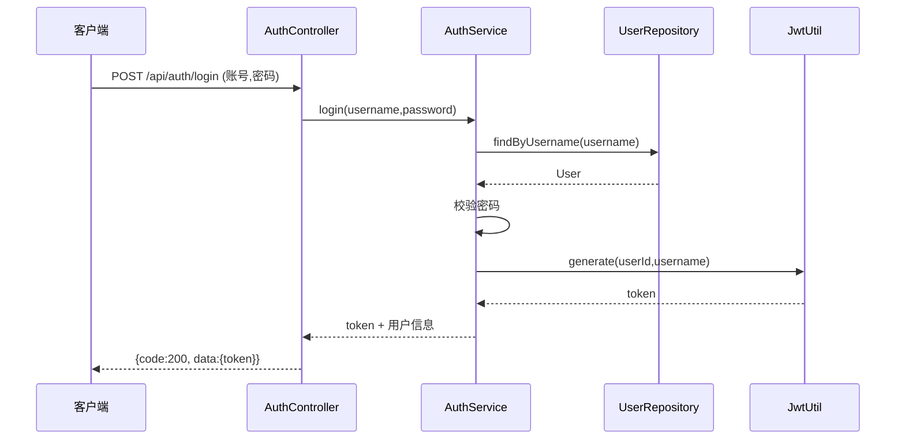
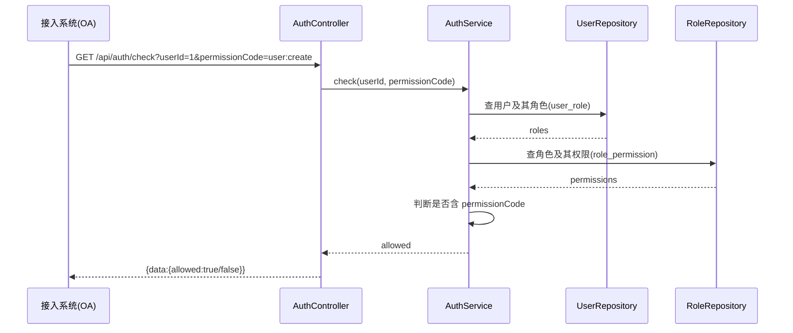
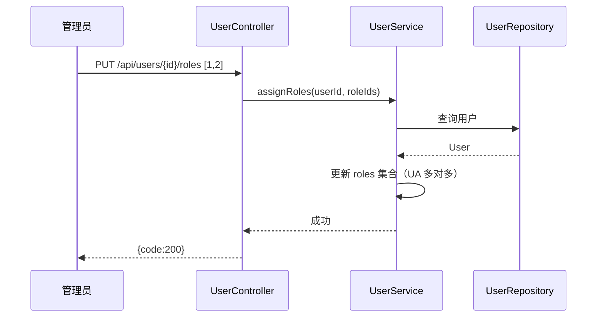

# 统一权限管理系统 — 详细设计

> 分层：Controller → Service → Repository → Entity（Spring Boot + Spring Data JPA）。

---

## 1. 类图



---

## 2. 顺序图

### 2.1 登录


### 2.2 鉴权检查（接入系统调用）


### 2.3 给用户分配角色


---

## 3. 核心设计要点

1. **多对多实现**：`User↔Role` 用 `@ManyToMany` + 中间表 `sys_user_role`；`Role↔Permission` 同理 `sys_role_permission`。
2. **鉴权逻辑**：`用户 →(UA)→ 角色 →(PA)→ 权限`，两级关联查询后判断目标权限码是否存在。
3. **默认拒绝**：`check` 未命中即返回 `false`，实现"初始无权限"。
4. **会话**：JWT 无状态，`AuthInterceptor` 拦截需要登录的接口校验 token，并把 userId 放入请求上下文。
5. **生命周期**：`status` 字段控制启用/停用；停用用户则鉴权立即拒绝。
6. **跨部门回收**：清空 `sys_user_role` 中该用户全部记录即可"杀死"旧权限，重新分配。

---

## 4. 模块分解（分解视角）

### 4.1 后端按职责拆分
```
rbac
├── common        ApiResponse / BusinessException / GlobalExceptionHandler
├── config        WebConfig（拦截器注册）
├── interceptor   AuthInterceptor（JWT 校验，注入 userId 到上下文）
├── controller    AuthController / UserController / RoleController / PermissionController
├── service       AuthService / UserService / RoleService / PermissionService
├── repository    UserRepository / RoleRepository / PermissionRepository
├── entity        User / Role / Permission（含 @ManyToMany 关联）
├── dto           LoginRequest / UserRequest / RoleRequest / PermissionRequest
└── util          JwtUtil / DataInitializer
```

### 4.2 前端按页面拆分
```
src
├── views         LoginView / LayoutView / UserManageView / RoleManageView / PermissionManageView
├── components    Modal / Transfer（穿梭框）
├── router        index.ts
├── mock          data.ts
└── types         index.ts
```

### 4.3 职责划分原则
- Controller 只做参数接收与响应包装，不含业务逻辑。
- Service 承载业务规则（默认拒绝、跨部门回收、状态判断）。
- Repository 只做数据访问；鉴权联表查询封装在 `UserRepository.countPermission`。
- 实体之间用 `@ManyToMany` + 中间表表达 RBAC0 的两类分配关系。
