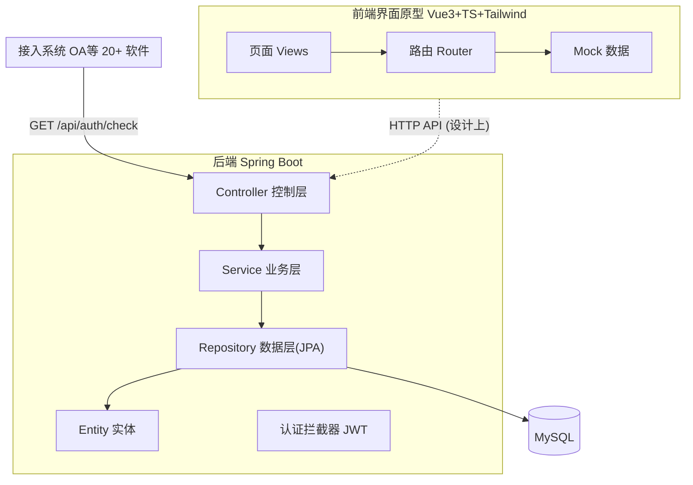
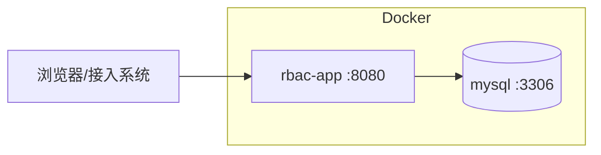

# 统一权限管理系统 — 软件设计文档（SDD）

> 版本：v0.1
> 配套文档：`01-需求分析`（Req-spec）、`03-API设计`、`04-数据库设计`、`05-详细设计`

---

## 1. 引言

### 1.1 目的
本文档描述"统一权限管理系统"的总体设计，包括架构、模块分解、技术选型与关键设计决策，是编码与测试的依据。

### 1.2 范围
第一轮交付：RBAC0 核心框架（后端 API + 前端界面原型）。

---

## 2. 总体架构

采用**前后端分离 + 分层架构**：



- 后端：`Controller → Service → Repository → Entity` 四层，`Interceptor` 做 JWT 认证。
- 前端：静态原型，用 Mock 数据，预留 API 对接位置。
- 接入系统：通过 `/api/auth/check` 实时鉴权。

---

## 3. 技术栈

| 层 | 技术 | 说明 |
|----|------|------|
| 后端 | Spring Boot 2.7 + Java 11 | Web + Data JPA |
| 后端 | Spring Security Crypto | BCrypt 密码加密 |
| 后端 | JJWT 0.11.5 | 无状态会话 token |
| 数据库 | MySQL 8 | utf8mb4 |
| 前端 | Vue 3 + TypeScript + Vite | 界面原型 |
| 前端 | Tailwind CSS | 样式 |
| API 工具 | Apifox | 导入 `03-API设计/openapi.json` |
| 测试 | JUnit 5 + Mockito | 单元测试 |
| 部署 | Docker + docker-compose | MySQL + 后端一键启动 |
| 协作 | Git + 共享记忆文档 | 版本控制与决策记录 |

---

## 4. 模块分解

### 4.1 后端模块（包结构）
```
com.example.rbac
├── common/         统一响应 ApiResponse、业务异常、全局异常处理
├── config/         拦截器注册 WebConfig
├── interceptor/    认证拦截器 AuthInterceptor（JWT 校验）
├── controller/     REST 控制层 Auth/User/Role/Permission
├── service/        业务层 Auth/User/Role/Permission
├── repository/     JPA 数据访问（含鉴权 count 查询）
├── entity/         User / Role / Permission
├── dto/            请求体 LoginRequest/UserRequest/RoleRequest/PermissionRequest
└── util/           JwtUtil、DataInitializer（初始化数据）
```

### 4.2 前端模块
```
src/
├── views/          页面：Login / Layout / UserManage / RoleManage / PermissionManage
├── components/     可复用组件：Modal 弹窗、Transfer 穿梭框
├── router/         路由配置
├── mock/           模拟数据（用户/角色/权限）
└── types/          TypeScript 类型定义
```

---

## 5. 数据库设计（概要）

详见 `04-数据库设计`。核心 5 张表：

| 表 | 作用 |
|----|------|
| sys_user | 用户 |
| sys_role | 角色（含可自定义 level 管理员等级） |
| sys_permission | 权限（= 资源 + 操作） |
| sys_user_role | 用户-角色 多对多（UA） |
| sys_role_permission | 角色-权限 多对多（PA） |

---

## 6. API 设计（概要）

详见 `03-API设计`（Markdown）与 `03-API设计/openapi.json`（Apifox 导入）。
鉴权路径：`用户 →(UA)→ 角色 →(PA)→ 权限`，单条联表 COUNT 查询。

---

## 7. 关键设计决策

| # | 决策 | 理由 |
|---|------|------|
| 1 | RBAC0 用「资源+操作」两段式表示权限 | 可自定义、语义清晰 |
| 2 | 会话用 JWT 无状态实现 | 扛早晚高峰并发，无需服务端存会话 |
| 3 | 鉴权默认拒绝（未命中即 false） | 满足"初始无权限" |
| 4 | 管理员等级用 role.level 字段 | "管理员等级可自定义、不定死" |
| 5 | 跨部门回收 = 清空用户角色 | 简单直接实现"杀死重开" |
| 6 | 生命周期先做启用/停用两态 | 第一轮最小闭环 |
| 7 | 前端第一轮做静态原型（Mock） | 先验证界面与流程，二轮再接 API |

---

## 8. 部署架构



`docker-compose up` 一键启动 MySQL 与后端，详见 `06-代码实现/rbac/docker-compose.yml`。
